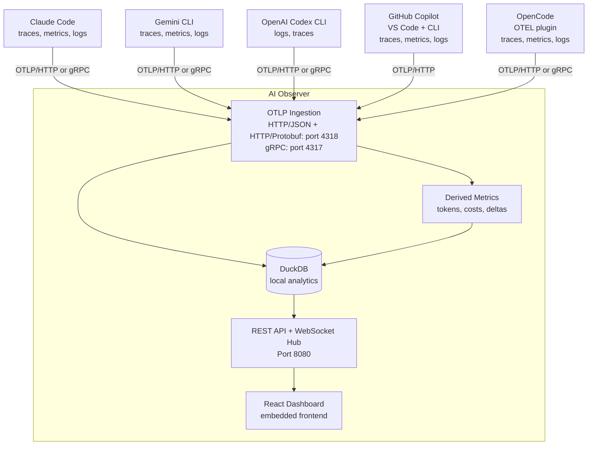
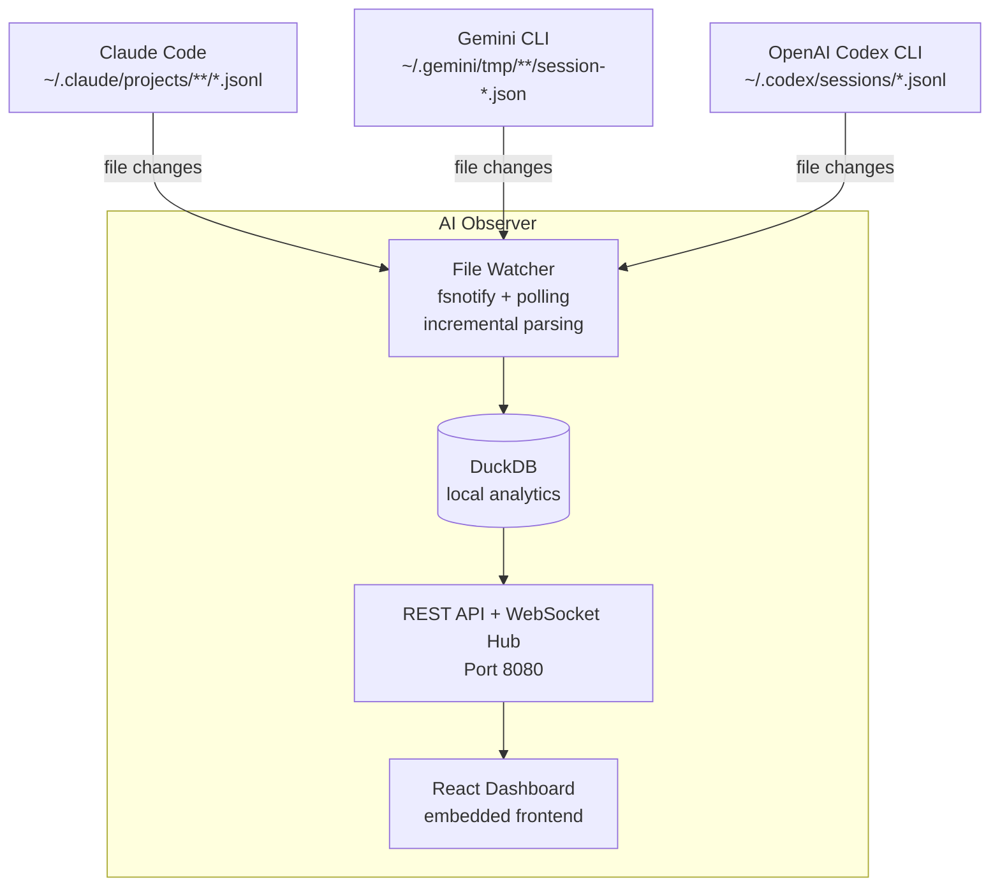
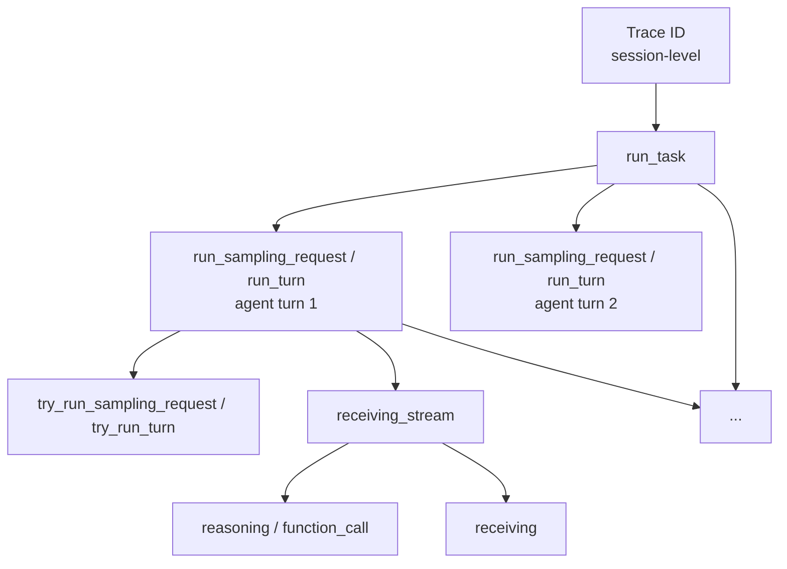

# AI Observer

> Unified local observability for AI coding assistants

**AI Observer** is a self-hosted, single-binary, OpenTelemetry-compatible observability backend designed specifically for monitoring local AI coding tools like Claude Code, Gemini CLI, OpenAI Codex CLI, GitHub Copilot, and OpenCode.

Track token usage, costs, API latency, error rates, and session activity across all your AI coding assistants in one unified dashboard—with real-time updates and zero external dependencies.

## Why AI Observer?

AI coding assistants are becoming essential development tools, but understanding their behavior and costs remains a challenge:

- **Visibility**: See exactly how your AI tools are performing across sessions
- **Cost tracking**: Monitor token usage and API calls to understand spending
- **Debugging**: Trace errors and slow responses back to specific interactions
- **Privacy**: Keep your telemetry data local—no third-party services required

## Features

- **Multi-tool support** — Works with Claude Code, Gemini CLI, OpenAI Codex CLI, GitHub Copilot, and OpenCode
- **Real-time dashboard** — Live updates via WebSocket as telemetry arrives
- **Persistent dashboards** — Drag-and-drop dashboard builder with saved widgets and multiple widget types
- **File watcher mode** — Watch Claude, Codex, and Gemini session files in real-time, no OTLP configuration needed
- **Historical import** — Import past Claude, Codex, and Gemini sessions from local JSONL/JSON files with cost calculation
- **Cost tracking** — Embedded pricing data across Claude, Codex/OpenAI, Gemini, and GitHub Copilot model aliases, plus native OpenCode plugin cost metrics
- **Fast analytics** — DuckDB-powered storage for instant queries on large datasets
- **Single binary** — One ~54MB executable with embedded frontend—no external dependencies
- **Multi-arch Docker** — Ready-to-run ~97MB images for `linux/amd64` and `linux/arm64`
- **OTLP-native** — Standard OpenTelemetry Protocol ingestion (HTTP/JSON, HTTP/Protobuf and gRPC)

## Documentation

- [Import Command](docs/import.md) — Import historical session data from local AI tool files
- [Export Command](docs/export.md) — Export telemetry data to Parquet files for archiving and sharing, and restore it
- [Maintenance](#maintenance) — Retention, size limit, compaction, backups and the admin API
- [API description](docs/openapi.json) — OpenAPI 3.1 description of the REST API, generated from the server's types
- [Watch Command](#watch-command) — Watch local session files and import incrementally in real-time
- [Agent Access (MCP)](docs/mcp.md) — Let Claude Code, Codex, Gemini CLI, Copilot or OpenCode search your conversations, logs, traces, metrics and costs
- [Redaction](docs/redaction.md) — Secrets (and optionally personal data) are replaced before telemetry is stored
- [Pricing System](docs/pricing.md) — Cost calculation for Claude, Codex/OpenAI, Gemini, and GitHub Copilot models; OpenCode costs are ingested from the OTEL plugin

## Screenshots

### Dashboard


### Metrics View


### Logs View


### Traces View


## Quick Start

### Using Docker (Recommended)

```bash
docker run -d \
  -p 127.0.0.1:8080:8080 \
  -p 127.0.0.1:4318:4318 \
  -p 127.0.0.1:4317:4317 \
  -v ai-observer-data:/app/data \
  --name ai-observer \
  tobilg/ai-observer:latest
```

Dashboard: http://localhost:8080

The ports are published on `127.0.0.1` only: AI Observer has no authentication unless you set `AI_OBSERVER_AUTH_TOKEN` and stores prompts, code and tool output (see [Network access](#network-access)). Drop the `127.0.0.1:` prefix only on trusted networks. Port 8080 serves the dashboard and API, 4318 OTLP/HTTP and 4317 OTLP/gRPC. The image's health check asks `/ready` (`ai-observer healthcheck`), so `docker ps` shows the container as healthy once its database answers.

**Using a local directory for data persistence:**

```bash
# Create a local data directory
mkdir -p ./ai-observer-data

# Run with local volume mount
docker run -d \
  -p 127.0.0.1:8080:8080 \
  -p 127.0.0.1:4318:4318 \
  -p 127.0.0.1:4317:4317 \
  -v $(pwd)/ai-observer-data:/app/data \
  -e AI_OBSERVER_DATABASE_PATH=/app/data/ai-observer.duckdb \
  --name ai-observer \
  tobilg/ai-observer:latest
```

This stores the DuckDB database in your local `./ai-observer-data` directory, making it easy to backup or inspect.

### Using Homebrew (macOS Apple Silicon)

```bash
brew tap tobilg/ai-observer
brew install ai-observer
ai-observer
```

### Using Binary

Download the latest release for your platform from [Releases](https://github.com/tobilg/ai-observer/releases), then:

```bash
./ai-observer
```

### Building from Source

```bash
git clone https://github.com/tobilg/ai-observer.git
cd ai-observer
make setup   # Install dependencies
make all     # Build single binary with embedded frontend
./bin/ai-observer
```

## Configuration

### Environment Variables

`ai-observer --help` lists all settings, grouped. Command-line flags of `serve`, `watch` and the other commands (`--host`, `--api-port`, `--otlp-port`, `--otlp-grpc-port`, `--db`, `--mcp`) override the variables of the same name. Invalid values are logged as warnings and replaced by the default.

| Variable | Default | Description |
|----------|---------|-------------|
| `AI_OBSERVER_HOST` | `127.0.0.1` (binary) or `0.0.0.0` (Docker) | Network interface the servers listen on, an IP address or host name (`--host`) |
| `AI_OBSERVER_API_PORT` | `8080` | HTTP server port (dashboard + API; `--api-port`) |
| `AI_OBSERVER_OTLP_PORT` | `4318` | OTLP/HTTP ingestion port (`--otlp-port`) |
| `AI_OBSERVER_OTLP_GRPC_PORT` | `4317` | OTLP/gRPC ingestion port; `0` or `off` turns it off (`--otlp-grpc-port`) |
| `AI_OBSERVER_FRONTEND_URL` | `http://localhost:5173` | Allowed CORS origin (dev mode) |
| `AI_OBSERVER_ALLOWED_HOSTS` | _(empty)_ | Comma-separated host names accepted by the dashboard/API (`Host` header) and as browser origins, in addition to IP addresses and `localhost`; `*` disables both checks |
| `AI_OBSERVER_MCP` | `false` | Serve the MCP endpoint for agents at `/mcp` on the API port; same as the `--mcp` flag of `serve` and `watch` (see [Agent Access](#agent-access-mcp)) |
| `AI_OBSERVER_ADMIN_API` | `false` | Serve the maintenance endpoints `/api/admin/*` and the Status page's Maintenance section (see [Maintenance](#maintenance)) |
| `AI_OBSERVER_AUTH_TOKEN` | _(empty: no authentication)_ | Shared token required on OTLP and API requests (see [Authentication](#authentication)) |
| `AI_OBSERVER_TLS_CERT`, `AI_OBSERVER_TLS_KEY` | _(empty: no TLS)_ | PEM certificate and private key: HTTPS on both HTTP ports and gRPC over TLS (see [TLS](#tls)) |
| `AI_OBSERVER_REDACT` | `secrets` | What is replaced in telemetry before it is stored: `secrets` (API keys, tokens, passwords), `all` (secrets and personal data such as emails and card numbers) or `off` (see [Redaction](docs/redaction.md)) |
| `AI_OBSERVER_DATABASE_PATH` | `./data/ai-observer.duckdb` (binary) or `/app/data/ai-observer.duckdb` (Docker) | DuckDB database file path (`--db`) |
| `AI_OBSERVER_DB_MEMORY_LIMIT` | _(empty: 80% of memory)_ | Memory DuckDB may use for data and queries, as a size such as `2GB` or `512MB`. Queries that need more use temporary files next to the database and get slower. The process uses more than this: the limit does not cover the server's own memory |
| `AI_OBSERVER_DB_THREADS` | _(empty: one per CPU core)_ | Number of threads DuckDB runs queries on |
| `AI_OBSERVER_RETENTION_DAYS` | _(empty: keep all)_ | `serve` and `watch` delete telemetry older than this many days, on startup and then hourly (a day at a time, so ingestion is not blocked) |
| `AI_OBSERVER_MAX_DB_SIZE` | _(empty: no limit)_ | `serve` and `watch` delete the oldest days while the stored data exceeds this size, such as `20GB` (KB, MB, GB and TB count in 1024s), never the last 24 hours (see [Maintenance](#maintenance)) |
| `AI_OBSERVER_STORE_ALL_SPANS` | `false` | Also store the spans left out as noise: Codex's spans for every streamed response event and session file write (see the Codex telemetry reference, Traces) |
| `AI_OBSERVER_BACKUP_DIR` | `backups` next to the database | Where the admin API writes backups and exports |
| `AI_OBSERVER_SKIP_MIGRATION_BACKUP` | `false` | Migrate the database without copying it to `<database>.pre-migration-v<N>` first |
| `AI_OBSERVER_LOG_LEVEL` | `INFO` | Log level: `DEBUG`, `INFO`, `WARN`, `ERROR` |
| `AI_OBSERVER_LOG_FORMAT` | `text` | Log format of all commands: `text` or `json` (one JSON object per line) |
| `AI_OBSERVER_CLAUDE_PATH` | `~/.config/claude/projects` and `~/.claude/projects` | Claude Code session directories to import and watch, comma-separated |
| `AI_OBSERVER_CODEX_PATH` | `$CODEX_HOME/sessions` or `~/.codex/sessions` | Codex session directory to import and watch |
| `AI_OBSERVER_GEMINI_PATH` | `$GEMINI_HOME/tmp` or `~/.gemini/tmp` | Gemini CLI directory to import and watch |
| `AI_OBSERVER_PRICING_DIR` | _(empty)_ | Directory with pricing files that add models or replace built-in prices, such as the current prices written by `pricing update` (see [Pricing](docs/pricing.md#overriding-prices)) |

CORS allows `AI_OBSERVER_FRONTEND_URL` plus `http://localhost:5173` and `http://localhost:8080`; set `AI_OBSERVER_FRONTEND_URL` when serving a custom UI origin. Browser requests and WebSocket connections are accepted from loopback origins, those CORS origins, origins whose host is in `AI_OBSERVER_ALLOWED_HOSTS`, and the dashboard's own origin when it is an IP address.

### Network Access

AI Observer has no authentication unless you set `AI_OBSERVER_AUTH_TOKEN` (see [Authentication](#authentication)), and the stored telemetry can include prompts, code and tool output. The binary therefore listens on `127.0.0.1` only, so the dashboard, API and OTLP endpoints are not reachable from other machines. To accept telemetry or dashboard requests from the network (for example from another machine or a dev container), set `AI_OBSERVER_HOST=0.0.0.0` and only do so on trusted networks. The Docker image listens on all interfaces inside the container; publish its ports to `127.0.0.1` (`-p 127.0.0.1:8080:8080`) to keep them local. The server logs a warning at startup when it listens beyond localhost without `AI_OBSERVER_AUTH_TOKEN`, or with it but without [TLS](#tls).

The dashboard and API only answer requests whose `Host` header is an IP address, `localhost`, the `AI_OBSERVER_FRONTEND_URL` host, or a name listed in `AI_OBSERVER_ALLOWED_HOSTS`. This blocks DNS rebinding attacks, where a malicious website points its own domain at `127.0.0.1` to read your local data. If you reach AI Observer through a host name such as `observer.lan`, add it to `AI_OBSERVER_ALLOWED_HOSTS`.

Both servers also reject requests that a browser sends from another site's origin. Otherwise any web page you visit could write fake telemetry to the OTLP port or change dashboards with requests that need no CORS preflight. A page whose own host name was rebound to `127.0.0.1` counts as another site too, unless its host is an IP address, `localhost` or in `AI_OBSERVER_ALLOWED_HOSTS`. Exporters and CLI tools send no `Origin` header and are not affected. The OTLP/gRPC port needs no such check: browsers cannot send gRPC requests to it.

### Authentication

Set `AI_OBSERVER_AUTH_TOKEN` to a long random value (for example `openssl rand -hex 32`) to require it on every request except `/health`, `/ready` and the dashboard's static files:

- **OTLP exporters** send it as a header: `OTEL_EXPORTER_OTLP_HEADERS="Authorization=Bearer <token>"` (Gemini CLI and Codex CLI take headers in their OTLP settings); over gRPC it is the `authorization` metadata.
- **Scripts** send `Authorization: Bearer <token>` to the API.
- **The dashboard** is opened once with `http://localhost:8080/?token=<token>`. AI Observer sets an HttpOnly, `SameSite=Strict` cookie for 30 days and removes the token from the address bar. The cookie holds a value derived from the token, not the token itself, so it cannot be used to send telemetry.

Requests without a valid token get `401`. After 10 different wrong tokens from one address within a minute, that address gets `429 Too Many Requests` (with `Retry-After`) for 5 minutes, even with the right token; requests without a token and repeats of the same wrong token (an exporter with an old one) do not count. Use HTTPS ([TLS](#tls) or a reverse proxy) when the token travels over a network.

The dashboard cookie cannot be revoked on its own: every browser that opened the dashboard with the token stays signed in for 30 days. To sign them all out, for example after a laptop was lost or the cookie was copied, change `AI_OBSERVER_AUTH_TOKEN` and restart; the cookies of the old token stop working, and exporters need the new token.

### TLS

Set `AI_OBSERVER_TLS_CERT` and `AI_OBSERVER_TLS_KEY` to the PEM files of a certificate and its private key to serve HTTPS on both HTTP ports (the dashboard at `https://host:8080` with WebSockets as `wss://`, OTLP/HTTP at `https://host:4318` with HTTP/2) and gRPC over TLS on 4317. Both are needed, and the server does not start when they cannot be loaded; the certificate is read at startup, so a renewed one needs a restart. Point exporters at the `https://` endpoints, and at the CA with `OTEL_EXPORTER_OTLP_CERTIFICATE` for a self-signed certificate. Use TLS with `AI_OBSERVER_AUTH_TOKEN` whenever AI Observer is reachable beyond localhost and no reverse proxy terminates TLS.

### Agent Access (MCP)

With `AI_OBSERVER_MCP=true` (or `ai-observer serve --mcp` / `watch --mcp`), AI Observer serves a [Model Context Protocol](https://modelcontextprotocol.io) endpoint at `http://localhost:8080/mcp`. Agents can then search earlier conversations, read transcripts, and look at logs, traces, metrics, token usage and costs, with read-only tools such as `search_conversations`, `get_transcript` and `usage_summary`. For Claude Code:

```bash
claude mcp add --transport http ai-observer http://localhost:8080/mcp
```

`search_conversations` finds the prompts, replies and tool calls that contain all words of a query, in any order and case (`flaky parser test`); words also match inside longer words (`retr` finds `retry` and `retries`), and `"quoted phrases"` match as written.

In hosts that render [MCP Apps](https://modelcontextprotocol.io/docs/extensions/apps), such as the Codex app, VS Code with GitHub Copilot or Cursor, the results of `usage_summary`, `query_metrics`, `get_trace` and `list_sessions` also appear as charts and tables in the conversation. Terminal agents get the same text results as before. Claude Desktop currently shows no views of a local AI Observer (see [Agent Access](docs/mcp.md#charts-in-mcp-apps-hosts)).

The endpoint is off by default and behind the same Host, Origin and token checks as the API; add `--header "Authorization: Bearer <token>"` when `AI_OBSERVER_AUTH_TOKEN` is set. What the tools return is sent to the agent's model provider. See [Agent Access (MCP)](docs/mcp.md) for the other tools' setup, all tools and their arguments.

### Redaction

Before telemetry is stored, AI Observer replaces secrets in it: API keys and tokens of common services (Anthropic, OpenAI, GitHub, AWS, Google, Slack, Stripe, …), JWTs, private keys, `Authorization` headers, passwords in URLs, and values of assignments such as `DB_PASSWORD=…`, for example with `[REDACTED:github_token]`. `AI_OBSERVER_REDACT=all` also replaces personal data (emails as stable pseudonyms, card numbers, IBANs, phone numbers, US SSNs, public IP addresses); `off` stores telemetry as received. Redaction applies to new telemetry from OTLP, `import` and `watch`. See [Redaction](docs/redaction.md).

### CLI Options

```bash
ai-observer [command] [options]
```

**Commands:**
| Command | Description |
|---------|-------------|
| `serve` | Receive OTLP telemetry (HTTP and gRPC) and serve the dashboard (default if no command); `--watch` also reads session files, `--mcp` serves the [MCP endpoint](#agent-access-mcp) |
| `watch` | Read local session files as they change and serve the dashboard, without OTLP |
| `import` | Import local session files once |
| `export` | Export telemetry data to Parquet files |
| `delete` | Delete telemetry in a time range |
| `backup` | Write a consistent copy of the database to a new file (see [Maintenance](#maintenance)) |
| `restore` | Load an export back into the database |
| `compact` | Rewrite the database into a new file without its free space |
| `setup` | Show setup instructions for AI tools |
| `pricing update` | Fetch current model prices from [models.dev](https://models.dev) into `AI_OBSERVER_PRICING_DIR` (see [Pricing](docs/pricing.md#updating-pricing)) |
| `healthcheck` | Exit 0 when the server on this machine is ready (`/ready`; the Docker image's health check) |

`ai-observer <command> --help` shows a command's options.

**Server options** (`serve`; `watch` takes `--host`, `--api-port`, `--db`, `--backfill` and `--mcp`):

| Option | Description |
|--------|-------------|
| `--watch [tool]` | Also read local session files as they change: `all` (default), `claude-code`, `codex` or `gemini` (see [OTLP and session files together](#otlp-and-session-files-together)) |
| `--backfill` | With `--watch`, import the existing files on the first start |
| `--mcp` | Serve the MCP endpoint `/mcp` for agents (`AI_OBSERVER_MCP`) |
| `--host host` | Interface to listen on, `0.0.0.0` for all (`AI_OBSERVER_HOST`) |
| `--api-port port` | API and dashboard port (`AI_OBSERVER_API_PORT`) |
| `--otlp-port port` | OTLP/HTTP port (`AI_OBSERVER_OTLP_PORT`) |
| `--otlp-grpc-port port` | OTLP/gRPC port, `0` or `off` to turn it off (`AI_OBSERVER_OTLP_GRPC_PORT`) |
| `--db file` | DuckDB database file (`AI_OBSERVER_DATABASE_PATH`; also on `import`, `export`, `delete`, `backup`, `restore`, `compact`) |

**Global Options:**
| Option | Description |
|--------|-------------|
| `-h`, `--help` | Show help message and exit |
| `-v`, `--version` | Show version information and exit |

**Examples:**

```bash
# Start the server (default, no command needed)
ai-observer

# Receive OTLP and read session files in one process
ai-observer serve --watch --backfill

# Other ports and database
ai-observer serve --api-port 9090 --otlp-port 4319 --otlp-grpc-port off --db ./other.duckdb

# Show version
ai-observer --version

# Show setup instructions for Claude Code
ai-observer setup claude-code

# Show setup instructions for GitHub Copilot
ai-observer setup github-copilot

# Show setup instructions for OpenCode
ai-observer setup opencode

# Import data from all file-backed AI tools
ai-observer import all

# Export data to Parquet files
ai-observer export all --output ./export

# Delete data in a date range
ai-observer delete all --from 2025-01-01 --to 2025-01-31

# Watch local session files for changes
ai-observer watch all
```

### Import Command

Import historical session data from local AI coding tool files into AI Observer.

```bash
ai-observer import [claude-code|codex|gemini|all] [options]
```

| Option | Description |
|--------|-------------|
| `--from DATE` | Only import sessions from DATE (YYYY-MM-DD) |
| `--to DATE` | Only import sessions up to DATE (YYYY-MM-DD) |
| `--force` | Re-import already imported files (their stored records are replaced) |
| `--dry-run` | Show what would be imported without making changes |
| `--yes` | Skip confirmation prompt |
| `--purge` | Replace the imported tools' data in the time range, including live OTLP telemetry: delete it, then re-import it from all of their files in that range, in one transaction per tool. Other tools' data is kept. With `--from`/`--to`, unchanged files in the range are rebuilt too; without them, the range is derived from the new and modified files |
| `--pricing-mode MODE` | Cost calculation mode for Claude: `auto` (default), `calculate`, `display` |
| `--verbose` | Show detailed progress |
| `--db FILE` | Database file (default `AI_OBSERVER_DATABASE_PATH`) |

**File locations:**

| Tool | Default Location |
|------|------------------|
| Claude Code | `~/.claude/projects/**/*.jsonl` |
| Codex CLI | `~/.codex/sessions/**/*.jsonl`, also compressed `*.jsonl.zst` |
| Gemini CLI | `~/.gemini/tmp/**/session-*.json` |

Override with environment variables: `AI_OBSERVER_CLAUDE_PATH`, `AI_OBSERVER_CODEX_PATH`, `AI_OBSERVER_GEMINI_PATH`

**Examples:**

```bash
# Import from all file-backed tools
ai-observer import all

# Import Claude data from specific date range
ai-observer import claude-code --from 2025-01-01 --to 2025-12-31

# Dry run to see what would be imported
ai-observer import all --dry-run

# Force re-import and recalculate costs (replaces the files' stored records)
ai-observer import claude-code --force --pricing-mode calculate
```

Re-importing a file that changed, or one forced with `--force`, replaces the records stored from it, also for files imported by earlier versions (live OTLP telemetry is kept). A `--from`/`--to` import of a file with records outside the range stores the range only; the next import adds the rest. With `--purge`, each tool's deletion and rebuild run in one transaction, so if one of its files fails, nothing of that tool changes.

> **After upgrading, re-import once with `--force`** (stop `watch` or `serve --watch` first; `watch` does not repair stored sessions, it only adds what is written after the upgrade):
> - `ai-observer import claude-code --force`: imports and `watch` dropped every prompt typed as plain text since v0.3.0.
> - `ai-observer import codex --force`: Codex imports stored only some tool calls (code mode's commands, patches, MCP and web tools were missing), and usage of sessions also sent over OTLP was counted twice. A plain `import codex` imports the compressed sessions (`.jsonl.zst`, which Codex writes for sessions older than 7 days and which earlier versions did not read), but keeps the old records of the others.
> - `ai-observer import gemini --force`: usage of sessions also sent over OTLP was counted twice.

**Codex sessions** are imported with every tool call (commands, patches, MCP and web tools, image views, also those run from code mode), with input, output, exit code and duration; a tool output is stored once, in the result's `tool.output` attribute (at most 16 KiB, start and end kept), and the log body names the tool, its exit code and the output size. Compressed session files (`.jsonl.zst`) are imported and watched like plain ones; a session counts as the same file before and after Codex compresses it.

**Large imports.** Importing all Codex sessions can take minutes and a lot of space: 714 files (about 4.4 GB of session data) took 285 seconds and gave a 2.87 GB database. DuckDB caches up to 80% of memory meanwhile (about 3 GB measured); `AI_OBSERVER_DB_MEMORY_LIMIT=512MB ai-observer import codex` kept that import below 0.9 GB.

A session that is also sent over OTLP is counted once: see [OTLP and session files together](#otlp-and-session-files-together).

The database can only be opened by one process at a time, so stop a running `ai-observer` server (or `watch`) before running `import`, `export`, `delete`, `backup`, `restore` or `compact`, or use the [admin API](#admin-api).

See [docs/import.md](docs/import.md) for detailed documentation and [docs/pricing.md](docs/pricing.md) for pricing calculation details.

### Watch Command

Watch local session files in real-time and import new data incrementally as it's written. This is an alternative to configuring OTLP exporters for Claude Code, Codex CLI, and Gemini CLI — just start the watcher and it picks up data from those tools' native log files.

```bash
ai-observer watch [claude-code|codex|gemini|all] [options]
```

| Option | Description |
|--------|-------------|
| `--backfill` | On first start, load all existing session data before watching |
| `--mcp` | Serve the [MCP endpoint](#agent-access-mcp) for agents (also `AI_OBSERVER_MCP=true`) |
| `--host`, `--api-port`, `--db` | Interface, API port and database file (see [Server options](#cli-options)) |

**How it works:**

- **First start (default):** Records the current position in each file without importing historical data. Only data written after startup is imported.
- **First start with `--backfill`:** Loads all existing session data, then watches for new changes.
- **Restart:** Resumes from where it left off, importing any data written while the watcher was stopped.

Claude Code and Codex logs and token/cost metrics receive repository attribution in both import and watch mode. The watcher retains repository context across restarts and recovers it from existing session files when needed. See [repository attribution](docs/import.md#repository-attribution-in-import-and-watch) for evidence precedence, reference-mining scope, and limits on updating historical records.

At startup, the watcher detects which tools are installed and reports their status:

```
File watcher starting...
  [claude-code] Watching ~/.claude/projects/ (2 directories)
  [codex]       Watching ~/.codex/sessions/ (1 directory)
  [gemini]      ~/.gemini/tmp/ not found — will poll for directory creation
```

Directories that don't exist yet are polled every 30 seconds and automatically added when they appear.

**File locations** are the same as the import command — override with `AI_OBSERVER_CLAUDE_PATH`, `AI_OBSERVER_CODEX_PATH`, `AI_OBSERVER_GEMINI_PATH`.

> **Note:** `watch` receives no OTLP. To receive OTLP and read session files in one process, use `ai-observer serve --watch` (below). GitHub Copilot and OpenCode are OTLP-only in AI Observer; use `serve` and the OTLP setup settings below.

**Examples:**

```bash
# Watch all file-backed tools for new data
ai-observer watch all

# Watch only Claude Code sessions
ai-observer watch claude-code

# First run: load all historical data, then watch
ai-observer watch all --backfill

# Watch Gemini CLI only
ai-observer watch gemini
```

### OTLP and session files together

`ai-observer serve --watch [all|claude-code|codex|gemini] [--backfill]` receives OTLP (HTTP and gRPC) and reads session files as they change, in one process with one database; the Status page shows the mode `serve+watch` and the watched tools. A session that reaches AI Observer both ways (over OTLP and from its file, also through `import`) is counted once:

| Tool | Token usage and cost | Transcript messages |
|------|----------------------|---------------------|
| Claude Code | Once: each request from OTLP when OTLP recorded it (matched by request ID, when the session also sends its token metrics over OTLP), from the file otherwise | Once (matched by entry, request and tool call IDs) |
| Codex | Once: a file response counts as recorded when an OTLP response of the same session has the same token counts within 30 seconds (Codex sends no shared ID) | Once (matched by tool call ID, prompts by time and text) |
| Gemini CLI | Once: a file response counts as recorded when an OTLP response of the same session has the same token counts within an hour (Gemini CLI sends no shared ID), when the session also sends its token metrics over OTLP | Once (prompts by text, or length, and time; responses by token counts; tool calls by tool and arguments) |

Usage that only the file recorded (before telemetry was enabled, or while AI Observer was down) or only OTLP recorded is kept. For Claude Code, usage stored twice by earlier versions is removed when the database is migrated; for Codex and Gemini CLI, run `ai-observer import codex --force` and `ai-observer import gemini --force` once (with `watch` stopped; `watch` does not repair it). Code mode's `write_stdin` and `curr_time` calls are not in Codex's session files, so they appear only over OTLP. Activity metrics that full Claude Code imports reconstruct (lines of code, commits, sessions, active time) are not deduplicated against OTLP's (see [docs/import.md](docs/import.md#claude-code-activity-metrics)); `watch` does not reconstruct them.

### Export Command

Export telemetry data to portable Parquet files with an optional DuckDB views database.

```bash
ai-observer export [claude-code|codex|gemini|opencode|copilot-chat|github-copilot|all] --output <directory> [options]
```

| Option | Description |
|--------|-------------|
| `--output DIR` | Output directory (required) |
| `--from DATE` | Start date filter (YYYY-MM-DD) |
| `--to DATE` | End date filter (YYYY-MM-DD) |
| `--from-files` | Read from raw JSON/JSONL files instead of database (redacted with `AI_OBSERVER_REDACT`) |
| `--zip` | Create single ZIP archive of exported files |
| `--dry-run` | Preview what would be exported |
| `--verbose` | Show detailed progress |
| `--yes` | Skip confirmation prompt |
| `--db FILE` | Database file (default `AI_OBSERVER_DATABASE_PATH`) |

**Output files:**
- `traces.parquet` — All trace/span data
- `logs.parquet` — All log records
- `metrics.parquet` — All metric data points
- `metric_baselines.parquet` — The kept last points of cumulative series, so restored charts keep their per-interval increases
- `import_state.parquet` — How far each session file of the exported records was read, so imports after a restore store nothing twice
- `dashboards.json` — All dashboards with their widgets
- `manifest.json` — Format (2), version, source, services, range and row counts of the export
- `ai-observer-export-{SOURCE}-{RANGE}.duckdb` — Views database with relative paths

A tool's export covers all of its services (`codex`: `codex_cli_rs`, `codex-app-server`, `codex-exec-server`), and all files are written from one snapshot of the database. Imported records keep the path of their session file, so **an export contains local file paths** (and the prompts, code and tool output of the sessions): check that before sharing it. `ai-observer restore` loads an export back (see [Maintenance](#maintenance)); earlier AI Observer versions cannot restore it (export format 2).

**Examples:**

```bash
# Export all data from database
ai-observer export all --output ./export

# Export Claude data with date filter
ai-observer export claude-code --output ./export --from 2025-01-01 --to 2025-01-15

# Export GitHub Copilot VS Code Extension telemetry
ai-observer export copilot-chat --output ./export

# Export OpenCode telemetry
ai-observer export opencode --output ./export

# Export to ZIP archive
ai-observer export all --output ./export --zip

# Export directly from raw files (without prior import)
ai-observer export claude-code --output ./export --from-files

# Dry run to preview export
ai-observer export all --output ./export --dry-run
```

> `--from-files` is only available for local file sources (`claude-code`, `codex`, `gemini`, `all`). GitHub Copilot and OpenCode are OTLP-only and export from the DuckDB database.

See [docs/export.md](docs/export.md) for detailed documentation.

### Delete Command

Delete telemetry data from the database by time range.

```bash
ai-observer delete [logs|metrics|traces|all] --from DATE --to DATE [options]
```

| Option | Description |
|--------|-------------|
| `--from DATE` | Start date (YYYY-MM-DD, required) |
| `--to DATE` | End date (YYYY-MM-DD, required) |
| `--service NAME` | Only delete data of a tool (`codex`: all three Codex services) or of one service name |
| `--yes` | Skip confirmation prompt |
| `--db FILE` | Database file (default `AI_OBSERVER_DATABASE_PATH`) |

**Examples:**

```bash
# Delete all data in a date range
ai-observer delete all --from 2025-01-01 --to 2025-01-31

# Delete only logs in a date range
ai-observer delete logs --from 2025-01-01 --to 2025-01-31

# Delete only Claude Code data
ai-observer delete all --from 2025-01-01 --to 2025-01-31 --service claude-code

# Skip confirmation prompt
ai-observer delete all --from 2025-01-01 --to 2025-01-31 --yes
```

Dates are days in your local time zone, as for `import` and `export`. Deleting keeps the import state, so a later plain `import` skips the files; `import <tool> --force` restores their records. After deleting, `delete` reports the database file's size and its free space, which new data reuses; `ai-observer compact` returns it to the disk (see [Maintenance](#maintenance)). While a server runs, use the admin API's `POST /api/admin/delete`: `delete` prints the matching `curl` command.

### Maintenance

**Disk space.** Deleting telemetry (`delete`, `AI_OBSERVER_RETENTION_DAYS`, `AI_OBSERVER_MAX_DB_SIZE`) frees space inside the database file, which new data reuses, but the file keeps its size. `ai-observer compact` (with the server stopped) copies the database into a new file without the free space, checks the copy (tables, row counts, indexes, schema version) and replaces the database with it; it needs free disk space of about the size of the data. A 751 MB database became 575 MB in 4.6 seconds, 398 MB after two days had been deleted. `--dry-run` shows the expected size, `--keep-original` keeps the old file as `<database>.pre-compact`. The Status page shows the free space and suggests compaction when at least 20% and 64 MB are free.

**Bounding growth.** By default AI Observer keeps all telemetry; the server logs the database size and its growth per day at startup and warns when a database of 1 GiB or more grows without bound. `AI_OBSERVER_RETENTION_DAYS` deletes telemetry older than that many days; `AI_OBSERVER_MAX_DB_SIZE` (such as `20GB`) deletes the oldest days while the stored data exceeds the size, measured as used space inside the file, not the file size, and never the last 24 hours. Both run at startup and then hourly.

**Backups.** `ai-observer backup --output <file>` writes a consistent, compacted copy of the database and checks it. To restore it, stop AI Observer and copy it over the database file (or point `AI_OBSERVER_DATABASE_PATH` at it). Before migrating a database to a new schema version, AI Observer copies it to `<database>.pre-migration-v<N>` (only the latest is kept): to go back to the earlier version, stop AI Observer and copy that file over the database. The copy needs free disk space of about the database's size; without it, AI Observer stops before migrating. `AI_OBSERVER_SKIP_MIGRATION_BACKUP=true` migrates without the copy.

**Restoring exports.** `ai-observer restore <export directory or .zip>` loads the spans, logs and metric points of an export, with its metric baselines and dashboards, in one transaction. It refuses when the database already holds records of the export's services in its time range, unless `--replace` deletes them first; `--dry-run` shows what it would do. To restore into a new database, pass `--db new.duckdb`. Text is redacted again with `AI_OBSERVER_REDACT`, as when telemetry is received (restoring 3.5 million records took 10 instead of 5.5 seconds).

Restored records keep the session file they were imported from, and the import state of those files is restored, so `import` and `watch` continue from there: unchanged files are skipped, grown files replace their records, and nothing is stored twice. A file the database had already imported with another state is read again by the next import or watch, replacing its records. On another computer or with another home directory the paths differ: pass `--map-path /Users/old=/Users/new` (repeatable) so the moved files are recognized; otherwise importing them stores them a second time. Exports of earlier versions (format 1) carry no paths: after restoring one, rebuild its sessions with `ai-observer import <tool> --purge` instead of a plain import.

#### Admin API

With `AI_OBSERVER_ADMIN_API=true` (off by default) the API port offers maintenance while the server runs, one operation at a time, behind the same Host, Origin and token checks as the API; protect it with `AI_OBSERVER_AUTH_TOKEN` when the server is reachable beyond localhost. Backups and exports are written to `AI_OBSERVER_BACKUP_DIR` (default: `backups` next to the database), under a name the request may give. The Status page then shows a Maintenance section.

```bash
# Count, then delete a range (a day per transaction, then a checkpoint)
curl -X POST http://localhost:8080/api/admin/delete -H 'Content-Type: application/json' \
  -d '{"from":"2026-01-01T00:00:00Z","to":"2026-02-01T00:00:00Z","service":"codex","dryRun":true}'
# Back up the database while it is in use
curl -X POST http://localhost:8080/api/admin/backup
# Export Claude Code's telemetry as a ZIP archive
curl -X POST http://localhost:8080/api/admin/export -H 'Content-Type: application/json' -d '{"source":"claude-code","zip":true}'
# Write the write-ahead log into the database file
curl -X POST http://localhost:8080/api/admin/checkpoint
```

`delete` also takes `scope` (`all`, `logs`, `metrics`, `traces`). Compaction is not offered, since it replaces the open file. `delete`, `export` and `backup` on the command line print the matching `curl` command when a server has the database open.

### AI Tool Setup

<details>
<summary><strong>Claude Code</strong></summary>

Configure the following environment variables:

```bash
# Enable telemetry (required)
export CLAUDE_CODE_ENABLE_TELEMETRY=1

# Configure exporters
export OTEL_METRICS_EXPORTER=otlp
export OTEL_LOGS_EXPORTER=otlp

# Set OTLP endpoint (HTTP)
export OTEL_EXPORTER_OTLP_PROTOCOL=http/protobuf
export OTEL_EXPORTER_OTLP_ENDPOINT=http://localhost:4318
# or OTLP/gRPC:
# export OTEL_EXPORTER_OTLP_PROTOCOL=grpc
# export OTEL_EXPORTER_OTLP_ENDPOINT=http://localhost:4317

# Set shorter intervals
export OTEL_METRIC_EXPORT_INTERVAL=10000  # 10 seconds (default: 60000ms)
export OTEL_LOGS_EXPORT_INTERVAL=5000     # 5 seconds (default: 5000ms)
```

Add these to your `~/.bashrc`, `~/.zshrc`, or shell profile to persist across sessions.

Claude Code will then automatically send metrics and events to AI Observer.

</details>

<details>
<summary><strong>Gemini CLI</strong></summary>
We assume you have at least Gemini CLI in version `v0.34.0` because all version before had a bug regarding OTLP publishing.

Add to `~/.gemini/settings.json`:

```json
{
  "telemetry": {
    "enabled": true,
    "target": "local",
    "useCollector": true,
    "otlpEndpoint": "http://localhost:4318",
    "otlpProtocol": "http",
    "logPrompts": true
  }
}
```

For OTLP/gRPC, set `"otlpProtocol": "grpc"` and `"otlpEndpoint": "http://localhost:4317"`.

**Required environment variables** (workaround for Gemini CLI timing issues):

```bash
export OTEL_METRIC_EXPORT_TIMEOUT=10000
export OTEL_LOGS_EXPORT_TIMEOUT=5000
```

</details>

<details>
<summary><strong>OpenAI Codex (CLI and app)</strong></summary>

Add to `~/.codex/config.toml`, which the CLI and the Codex app both read:

```toml
[otel]
log_user_prompt = true  # set to false to redact prompts
exporter = { otlp-http = { endpoint = "http://localhost:4318/v1/logs", protocol = "binary" } }
trace_exporter = { otlp-http = { endpoint = "http://localhost:4318/v1/traces", protocol = "binary" } }
metrics_exporter = { otlp-http = { endpoint = "http://localhost:4318/v1/metrics", protocol = "binary" } }
```

> **Note**: without `trace_exporter`, Codex sends traces to the logs endpoint.

For OTLP/gRPC, use `otlp-grpc` exporters instead, for example `exporter = { otlp-grpc = { endpoint = "http://localhost:4317" } }`.

**Codex 0.167 and later** run conversations in an app server: the Codex app starts its own, and the CLI starts a background one (`app-server-daemon`) once and keeps using it. That server keeps the settings it started with, so after changing `[otel]` quit Codex, stop it (`pkill -f app-server-daemon`) and start Codex again. Codex then sends three service names, which AI Observer all counts as Codex:

| `service.name` | Sent by | Contains |
|---|---|---|
| `codex_cli_rs` | the CLI | its startup telemetry (older versions: everything) |
| `codex-app-server` | the app server of the Codex app or the CLI | conversations, tokens, the traces of turns (`turn/start`); `originator` is `Codex_Desktop` for the app, `codex-tui` for the CLI |
| `codex-exec-server` | the Codex app's command runner | process and request metrics |

Most of the app and exec servers' traces are internal requests outside a conversation (`fs.read_file`, `getAuthStatus`, `thread/read`, …), hundreds per hour, and each automatic approval review is a trace of its own (`decide_request`). The trace list leaves them out unless you turn on **Background requests**.

</details>

<details>
<summary><strong>OpenCode</strong></summary>

OpenCode telemetry is available through the third-party [`@devtheops/opencode-plugin-otel`](https://github.com/DEVtheOPS/opencode-plugin-otel) plugin. AI Observer receives it over OTLP/HTTP on port `4318` or OTLP/gRPC on port `4317`.

Add to `~/.config/opencode/opencode.json`:

```json
{
  "$schema": "https://opencode.ai/config.json",
  "plugin": ["@devtheops/opencode-plugin-otel"]
}
```

Add to your `~/.bashrc`, `~/.zshrc`, or shell profile:

```bash
export OPENCODE_ENABLE_TELEMETRY=1
export OPENCODE_OTLP_ENDPOINT=http://localhost:4318
export OPENCODE_OTLP_PROTOCOL=http/protobuf
```

> The plugin defaults to OTLP/gRPC, which AI Observer also receives: leave `OPENCODE_OTLP_PROTOCOL` unset and set `OPENCODE_OTLP_ENDPOINT=http://localhost:4317`.

</details>

<details>
<summary><strong>GitHub Copilot</strong></summary>

GitHub Copilot can export OTLP telemetry from the VS Code extension and CLI. AI Observer stores the raw telemetry and derives token and cost metrics from chat spans.

**VS Code settings:**

```json
{
  "github.copilot.chat.otel.enabled": true,
  "github.copilot.chat.otel.exporterType": "otlp-http",
  "github.copilot.chat.otel.otlpEndpoint": "http://localhost:4318",
  "github.copilot.chat.otel.captureContent": true
}
```

**Environment variables:**

```bash
export COPILOT_OTEL_ENABLED=true
export OTEL_EXPORTER_OTLP_ENDPOINT=http://localhost:4318
export OTEL_EXPORTER_OTLP_PROTOCOL=http/protobuf
export COPILOT_OTEL_CAPTURE_CONTENT=true
```

Service names:

| Service | Source |
|---------|--------|
| `copilot-chat` | GitHub Copilot VS Code Extension |
| `github-copilot` | GitHub Copilot CLI |

Copilot transcripts use conversation content captured in GenAI spans and supported log events. Enable content capture as shown above and send traces to AI Observer to include prompts, assistant replies, tool calls, and tool results. A session can appear in the session list without captured messages; its transcript then shows "No messages in this session". Enabling capture later does not recover content that was never recorded.

> Content capture can include prompts, code, tool arguments, and tool results. Only enable it in trusted local environments.

</details>

## Architecture

**OTLP mode** (`ai-observer` or `ai-observer serve`):



**File watcher mode** (`ai-observer watch all`):



GitHub Copilot and OpenCode are not shown in watcher mode because AI Observer currently receives their telemetry through OTLP only. `ai-observer serve --watch` combines both modes in one process (see [OTLP and session files together](#otlp-and-session-files-together)).

**Tech Stack**:
- **Backend**: Go 1.26+, chi router, DuckDB 2.0.0, gorilla/websocket
- **Frontend**: React 19, TypeScript, Vite, Tailwind CSS v4, Zustand, Recharts

## API Reference

AI Observer listens on three ports: OTLP/HTTP (4318), OTLP/gRPC (4317) and the REST API with the dashboard (8080). [`docs/openapi.json`](docs/openapi.json) describes the REST API, the OTLP/HTTP endpoints and the WebSocket message as OpenAPI 3.1. It is generated from the server's types, so it matches what the server sends: optional fields may be missing, `null` appears only where the description allows it, and lists are always arrays.

### OTLP Ingestion (Ports 4318 and 4317)

Standard OpenTelemetry Protocol endpoints for receiving telemetry data.
- OTLP/HTTP on 4318: HTTP/1.1 and h2c (HTTP/2 via ALPN with TLS). Request bodies may be compressed with `Content-Encoding` `gzip`, `deflate` or `identity`; other encodings, such as `zstd`, are answered `415` with `Accept-Encoding: gzip, deflate, identity`.
- OTLP/gRPC on 4317: the OTLP trace, metrics and logs services, with gzip compression (`AI_OBSERVER_OTLP_GRPC_PORT`, `off` turns it off).

| Method | Endpoint | Description |
|--------|----------|-------------|
| `POST` | `/v1/traces` | Ingest trace spans (protobuf or JSON) |
| `POST` | `/v1/metrics` | Ingest metrics (protobuf or JSON) |
| `POST` | `/v1/logs` | Ingest logs (protobuf or JSON) |
| `GET` | `/health` | Liveness: `200` while the server runs |
| `GET` | `/ready` | Readiness: `200`, or `503` when the database does not answer within 2 seconds |

Telemetry that cannot be stored is answered with `503` and `Retry-After` (gRPC: `UNAVAILABLE`), which exporters retry; a payload over the 10 MB limit, also after decompression, gets `413` (gRPC: `RESOURCE_EXHAUSTED`). Records the OTLP specification calls invalid are left out and reported as `partial_success` (`rejected_spans`, `rejected_data_points`, `error_message`): spans with missing or all-zero trace or span IDs, number data points without a value and histogram points whose bucket counts do not match their bounds; metrics without data points are reported as a warning.

### Query API (Port 8080)

REST API for querying stored telemetry data. Unless otherwise specified, `from`/`to` default to the last 24 hours. Invalid parameters answer `400` with a message naming them; `limit` must be a positive number, and values above an endpoint's maximum are reduced to it. Lists are `[]` when empty.

<details>
<summary><strong>Traces</strong></summary>

| Method | Endpoint | Description |
|--------|----------|-------------|
| `GET` | `/api/traces` | List traces with filtering and pagination; each row describes the whole trace (all of its spans), ordered by the trace's first span in the range |
| `GET` | `/api/traces/recent` | Get most recent traces (`limit`, default 50, at most 100) |
| `GET` | `/api/traces/{id}?kind={kind}` | Get spans for a trace row (same as `/spans`) |
| `GET` | `/api/traces/{id}/spans?kind={kind}` | Get a page of the spans of a trace row, oldest first: `limit` (default and maximum 1,000) and `cursor` (the previous page's `nextCursor`). The response also carries `trace` (start, duration, span count and status of the whole trace), `total` and `hasMore` |

**Query parameters for `/api/traces`:**
- `service` — Filter by service name, or by tool name (`codex` covers `codex_cli_rs`, `codex-app-server` and `codex-exec-server`; the other list endpoints accept tool names too)
- `search` — Full-text search
- `background=true` — Also list the background traces of Codex's app and exec servers: traces in which no span belongs to a conversation (internal file, settings and account requests), automatic approval reviews and the CLI's startup spans, which are left out by default
- `from`, `to` — Time range (ISO 8601)
- `limit`, `cursor` — Pagination: pass the `nextCursor` of the previous page as `cursor` (`offset` still works up to 10,000 rows but is deprecated)

Trace list rows include `id`, `kind`, `traceId`, and `rootSpanId`. Use the `id` and `kind` values from a trace row when requesting details. Most rows, including GitHub Copilot and raw Codex session traces, use `kind=otel_trace` with `id` set to the OTLP trace ID. Codex operation rows, where present, use `kind=codex_operation` with `id`/`rootSpanId` set to the operation root span ID.

</details>

<details>
<summary><strong>Metrics</strong></summary>

| Method | Endpoint | Description |
|--------|----------|-------------|
| `GET` | `/api/metrics` | List metric points with filtering (`type`: `gauge`, `sum`, `histogram`, `exponential_histogram`, `summary`) |
| `GET` | `/api/metrics/names` | List all metric names |
| `GET` | `/api/metrics/breakdown-values` | The values of a metric's attribute (`name`, `attribute`, `service`) |
| `GET` | `/api/metrics/attribute-keys` | The attribute keys of a metric's points, which series can be grouped and filtered by (`name`, `service`) |
| `GET` | `/api/metrics/series` | Get time series data for a metric |
| `POST` | `/api/metrics/batch-series` | Get multiple time series in one request |

**Query parameters for `/api/metrics/series`:**
- `name` — Metric name (required)
- `service` — Filter by service or tool name
- `from`, `to` — Time range (RFC 3339)
- `interval` — Bucket size in whole seconds, from 1 to 2,678,400 (31 days), e.g. `60`, `3600`, `86400` (default `60`); ranges that would need more than about 2,000 buckets get a coarser one, which the response's `interval` names
- `aggregate` — One total per series over the range instead of buckets (default: `false`)
- `groupBy` — Up to two attribute keys, comma-separated (`model`, `model,repository`): one series per service and value instead of per token type
- `attr.<key>=<value>` — Keep only points whose attribute has the value, e.g. `attr.model=claude-sonnet-5-5` (at most 10)
- `stat` — Statistic of a histogram metric: `avg` (default), `sum`, `count`, `min`, `max`, `p50`, `p90`, `p95`, `p99` (percentiles are estimated from the buckets by linear interpolation)
- `merge` — One series of all matching points (default: `false`)
- `tz` — IANA time zone the buckets follow, such as `Europe/Berlin` (default `UTC`): a daily bucket is a local day, also across daylight saving changes

Cumulative counters are turned into per-interval increases. Buckets without points are `null` for gauges and for a histogram's average, minimum, maximum and percentiles; sums and counts are `0`. A bucketed query returns at most 100 series. The response carries `series`, `metricType`, `stat` (histograms), `interval` and `timeZone`.

**Batch series (`POST /api/metrics/batch-series`) request body:**
- `from`, `to` (default: the last 24 hours), `interval` (seconds, as above), `timeZone`, and `queries`.
- Each query requires `id` and `name`; optional `service`, `aggregate`, `groupBy` (array), `filters` (`{"model": "…"}`), `stat`, `merge`.
- Maximum 50 queries per request. A query that fails reports `success: false` with `error` and a `code` (`invalid_group_by`, `invalid_filter`, `invalid_stat`, `too_many_series`, `timeout`, …) without affecting the others.

</details>

<details>
<summary><strong>Logs</strong></summary>

| Method | Endpoint | Description |
|--------|----------|-------------|
| `GET` | `/api/logs` | List logs with filtering and pagination |
| `GET` | `/api/logs/levels` | Get log counts by severity level (optional `from`/`to`) |

**Query parameters for `/api/logs`:**
- `service` — Filter by service name
- `severity` — Filter by severity (TRACE, DEBUG, INFO, WARN, ERROR, FATAL)
- `traceId` — Filter logs linked to a specific trace
- `search` — Case-insensitive substring of the body or an attribute value (a term with quotes, backslashes, line breaks, `<`, `>` or `&` reads every attribute value and is 1.4 to 2.4 times slower)
- `from`, `to` — Time range (ISO 8601)
- `limit`, `cursor` — Pagination: pass the `nextCursor` of the previous page as `cursor` (`offset` still works up to 10,000 rows but is deprecated)

</details>

<details>
<summary><strong>Sessions</strong></summary>

| Method | Endpoint | Description |
|--------|----------|-------------|
| `GET` | `/api/sessions` | List the sessions with activity in the range, most recently active first, each with its whole extent |
| `GET` | `/api/sessions/{id}/transcript` | Get a page of a session's messages, oldest first, with `title` and `totals` over all messages. A message recorded both in the session file and over OTLP appears once (Claude Code, Codex; not Gemini CLI) |

**Query parameters for `/api/sessions`:**
- `service` — Filter by service or tool name
- `search` — Words and `"quoted phrases"` (at most 10 terms): sessions with a log or span record in the range that contains all of them, newest match first, each with `snippet`, `matches` and `matchedAt`
- `from`, `to` — Time range (ISO 8601)
- `limit`, `cursor` — Pagination (`limit` default 50, at most 1,000)

Rows carry `sessionId`, `serviceName`, `startTime`, `lastTime`, `messageCount`, `model` and, where known, `title` (the first prompt), `repository` and `branch` (imported and watched Claude Code and Codex sessions), `costUsd`, `inputTokens` and `outputTokens` (sessions whose events carry usage, such as Claude Code over OTLP; not Codex, imported Claude Code or GitHub Copilot).

**Query parameters for `/api/sessions/{id}/transcript`:**
- `limit`, `cursor` — Pagination (`limit` default 500, at most 1,000)
- `search` — Adds `search.matches`: the positions (0-based, in the whole transcript) of the messages that contain all terms, so a client can load pages up to a match

Logs, spans and traces carry the `sessionId` of their session (a trace when all its spans with a session share one); it can be passed to the transcript endpoint.

</details>

<details>
<summary><strong>Dashboards</strong></summary>

| Method | Endpoint | Description |
|--------|----------|-------------|
| `GET` | `/api/dashboards` | List all dashboards |
| `POST` | `/api/dashboards` | Create a new dashboard |
| `GET` | `/api/dashboards/default` | Get the default dashboard with widgets (created with its default widgets when there is none) |
| `GET` | `/api/dashboards/{id}` | Get a dashboard by ID |
| `PUT` | `/api/dashboards/{id}` | Update a dashboard |
| `DELETE` | `/api/dashboards/{id}` | Delete a dashboard |
| `PUT` | `/api/dashboards/{id}/default` | Set as default dashboard |
| `POST` | `/api/dashboards/{id}/widgets` | Add a widget |
| `PUT` | `/api/dashboards/{id}/widgets/positions` | Update widget positions |
| `PUT` | `/api/dashboards/{id}/widgets/{widgetId}` | Update a widget: `title`, position, `colSpan` (at most 4), `rowSpan`, `config` (omitted: kept; sent: replaces the stored one) |
| `DELETE` | `/api/dashboards/{id}/widgets/{widgetId}` | Delete a widget |

</details>

<details>
<summary><strong>Other</strong></summary>

| Method | Endpoint | Description |
|--------|----------|-------------|
| `GET` | `/api/services` | List all services sending telemetry |
| `GET` | `/api/providers` | List the supported AI coding tools with their service and display names |
| `GET` | `/api/stats` | Get aggregate statistics (optional `from`/`to` count only that range) |
| `GET` | `/api/status` | Server status: version, mode (`serve`, `watch`, `serve+watch`), endpoints, database size and free space, stored telemetry, settings, pricing files, imported session files |
| `GET` | `/ws` | WebSocket for real-time updates |
| `POST` | `/mcp` | MCP endpoint for agents (Streamable HTTP), when enabled with `AI_OBSERVER_MCP=true` or `--mcp`; see [Agent Access (MCP)](docs/mcp.md) |
| `POST` | `/api/admin/delete`, `/api/admin/export`, `/api/admin/backup`, `/api/admin/checkpoint` | Maintenance, when enabled with `AI_OBSERVER_ADMIN_API=true`; see [Admin API](#admin-api) |
| `GET` | `/metrics` | AI Observer's own metrics in the Prometheus text format (see below) |
| `GET` | `/api/internal/metrics` | The same metrics as JSON |
| `GET` | `/health` | Liveness: `200` while the server runs (no token needed) |
| `GET` | `/ready` | Readiness: `503` when the database does not answer within 2 seconds (no token needed); use it for container or orchestrator probes |

**Monitoring AI Observer itself.** `GET /metrics` serves AI Observer's own metrics for Prometheus: OTLP requests by transport (`http`, `grpc`) and result, records stored, rejected and deduplicated, noise spans dropped, write transaction durations and lock waits, API request durations and timeouts by route, WebSocket clients, watcher files and errors, retention deletions and failed authentication. With `AI_OBSERVER_AUTH_TOKEN`, scrape with `Authorization: Bearer <token>`.

</details>

## Data Collected

AI Observer receives standard OpenTelemetry data:

| Signal | Description | Example Data |
|--------|-------------|--------------|
| **Traces** | Distributed tracing spans | API calls, tool executions, session timelines |
| **Metrics** | Numeric measurements | Token counts, latency histograms, request rates |
| **Logs** | Structured log records | Errors, prompts (if enabled), system events |

All data is stored locally in DuckDB. Nothing is sent to external services.

## Telemetry Reference

Each AI coding tool exports different telemetry signals. Here's what you can observe:

<details>
<summary><strong>Claude Code Metrics & Events</strong></summary>

### Metrics

| Metric | Display Name | Type | Description |
|--------|--------------|------|-------------|
| `claude_code.session.count` | Sessions | Counter | CLI sessions started; full imports count non-empty session files |
| `claude_code.token.usage` | Token Usage | Counter | Tokens used (by type: input/output/cache) |
| `claude_code.cost.usage` | Cost | Counter | Session cost in USD |
| `claude_code.lines_of_code.count` | Lines of Code | Counter | Lines of code modified (added/removed) |
| `claude_code.pull_request.count` | Pull Requests | Counter | Pull requests created in live telemetry; full imports count distinct repository/PR links per file |
| `claude_code.commit.count` | Commits | Counter | Git commits created |
| `claude_code.code_edit_tool.decision` | Edit Decisions | Counter | Tool permission decisions (accept/reject) |
| `claude_code.active_time.total` | Active Time | Counter | Active time in seconds; full imports approximate it from recorded turn durations |

**Common attributes**: `session.id`, `organization.id`, `user.account_uuid`, `terminal.type`, `model`

Full imports reconstruct lines of code and commits only from supported successful tool results. Imported PR links do not prove PR creation, session-file counts do not measure CLI launches, and turn durations exclude user typing/reading time. The incremental watcher imports transcripts and token/cost usage without reconstructing these activity metrics. See [activity reconstruction rules](docs/import.md#claude-code-activity-metrics) for details and how to avoid counting overlapping imports and live telemetry twice.

Claude Code and Codex logs and token/cost metrics from import and watch also receive `repository` and `git_branch` when evidence is available. See [repository attribution](docs/import.md#repository-attribution-in-import-and-watch) for selection rules and restart behavior.

### Derived Metrics

AI Observer computes user-facing metrics that filter out tool-routing API calls (which have no cache tokens). These metrics match the token counts shown by tools like [ccusage](https://github.com/ryoppippi/ccusage):

| Metric | Display Name | Description |
|--------|--------------|-------------|
| `claude_code.token.usage_user_facing` | Token Usage (User-Facing) | Tokens from user-facing API calls only (excludes tool-routing) |
| `claude_code.cost.usage_user_facing` | Cost (User-Facing) | Cost from user-facing API calls only (excludes tool-routing) |

> **Note**: Claude Code makes internal API calls for tool routing that don't involve user interaction. These calls have no cache tokens. The user-facing metrics exclude these calls to provide counts that match what users see in their billing and usage reports.

### Events (Logs)

| Event | Display Name | Description | Key Attributes |
|-------|--------------|-------------|----------------|
| `claude_code.user_prompt` | User Prompt | User submits a prompt | `prompt_length`, `prompt` (if enabled) |
| `claude_code.api_request` | API Request | API request to Claude | `model`, `cost_usd`, `duration_ms`, `input_tokens`, `output_tokens` |
| `claude_code.api_error` | API Error | Failed API request | `error`, `status_code`, `attempt` |
| `claude_code.tool_result` | Tool Result | Tool execution completes | `tool_name`, `success`, `duration_ms`, `decision` |
| `claude_code.tool_decision` | Tool Decision | Permission decision made | `tool_name`, `decision`, `source` |

</details>

<details>
<summary><strong>Gemini CLI Metrics & Logs</strong></summary>

### Metrics

| Metric | Display Name | Type | Description |
|--------|--------------|------|-------------|
| `gemini_cli.session.count` | Sessions | Counter | Sessions started |
| `gemini_cli.token.usage` | Token Usage | Counter | Tokens by type (`input` includes `cache`; `output`, `thought`, `tool`) |
| `gemini_cli.cost.usage` | Cost | Counter | Session cost in USD; cached tokens at the cache rate only |
| `gemini_cli.api.request.count` | API Requests | Counter | API requests by model and status |
| `gemini_cli.api.request.latency` | API Latency | Histogram | API request duration (ms) |
| `gemini_cli.api.request.breakdown` | API Request Breakdown | Histogram | Request phase analysis (ms) |
| `gemini_cli.tool.call.count` | Tool Calls | Counter | Tool invocations with success/decision |
| `gemini_cli.tool.call.latency` | Tool Latency | Histogram | Tool execution duration (ms) |
| `gemini_cli.tool.queue.depth` | Tool Queue Depth | Histogram | Number of pending tools in queue |
| `gemini_cli.tool.execution.breakdown` | Tool Execution Breakdown | Histogram | Phase-level tool execution durations (ms) |
| `gemini_cli.file.operation.count` | File Operations | Counter | File operations by type and language |
| `gemini_cli.lines.changed` | Lines Changed | Counter | Lines added/removed |
| `gemini_cli.agent.run.count` | Agent Runs | Counter | Agent executions |
| `gemini_cli.agent.duration` | Agent Duration | Histogram | Agent run duration (ms) |
| `gemini_cli.agent.turns` | Agent Turns | Histogram | Interaction iterations per agent run |
| `gemini_cli.startup.duration` | Startup Duration | Histogram | Initialization time by phase (ms) |
| `gemini_cli.memory.usage` | Memory Usage | Histogram | Memory consumption (bytes) |
| `gemini_cli.cpu.usage` | CPU Usage | Histogram | Processor utilization (%) |
| `gemini_cli.chat_compression` | Chat Compression | Counter | Context compression events |
| `gemini_cli.chat.invalid_chunk.count` | Invalid Chunks | Counter | Malformed stream data count |
| `gemini_cli.chat.content_retry.count` | Content Retries | Counter | Recovery attempt count |
| `gemini_cli.chat.content_retry_failure.count` | Retry Failures | Counter | Exhausted retry attempts count |
| `gemini_cli.slash_command.model.call_count` | Model Commands | Counter | Model selections via slash commands |
| `gemini_cli.model_routing.latency` | Routing Latency | Histogram | Router decision timing (ms) |
| `gemini_cli.model_routing.failure.count` | Routing Failures | Counter | Model routing failure count |
| `gemini_cli.ui.flicker.count` | UI Flicker | Counter | Rendering instability events |
| `gemini_cli.token.efficiency` | Token Efficiency | Histogram | Output quality metrics ratio |
| `gemini_cli.performance.score` | Performance Score | Histogram | Composite performance benchmark |
| `gemini_cli.performance.regression` | Performance Regressions | Counter | Performance degradation count |
| `gemini_cli.performance.regression.percentage_change` | Regression Percentage | Histogram | Performance variance magnitude (%) |
| `gemini_cli.performance.baseline.comparison` | Baseline Comparison | Histogram | Performance baseline drift (%) |
| `gen_ai.client.token.usage` | GenAI Token Usage | Histogram | Token consumption (OTel semantic convention) |
| `gen_ai.client.operation.duration` | GenAI Operation Duration | Histogram | Operation timing in seconds (OTel semantic convention) |

### Derived Metrics

Gemini CLI sends cumulative counters. Their charts show the increase per interval, computed per series (each Gemini process has its own `session.id`). The `.delta` names of earlier versions are no longer listed, but widgets and queries that use them keep working and return the same per-interval series:

| Metric | Display Name | Description |
|--------|--------------|-------------|
| `gemini_cli.session.count.delta` | Sessions | Sessions per interval |
| `gemini_cli.token.usage.delta` | Token Usage | Tokens consumed per interval |
| `gemini_cli.api.request.count.delta` | API Requests | API requests per interval |
| `gemini_cli.file.operation.count.delta` | File Operations | File operations per interval |

### Logs

| Log | Display Name | Description |
|-----|--------------|-------------|
| `gemini_cli.config` | Config | Startup configuration (model, sandbox, tools, extensions) |
| `gemini_cli.user_prompt` | User Prompt | User prompt with length and auth type |
| `gemini_cli.api_request` | API Request | API request details |
| `gemini_cli.api_response` | API Response | Response with token counts and finish reason |
| `gemini_cli.api_error` | API Error | Failed requests with error details |
| `gemini_cli.tool_call` | Tool Call | Tool execution with duration and arguments |
| `gemini_cli.file_operation` | File Operation | File create/read/update operations |
| `gemini_cli.agent.start` / `agent.finish` | Agent Start/Finish | Agent lifecycle events |
| `gemini_cli.model_routing` | Model Routing | Routing decisions with latency |
| `gemini_cli.chat_compression` | Chat Compression | Context compression events |
| `gemini_cli.conversation_finished` | Conversation Finished | Session completion with turn count |

</details>

<details>
<summary><strong>GitHub Copilot Metrics, Logs & Traces</strong></summary>

GitHub Copilot exports OTLP telemetry from the VS Code extension and CLI. AI Observer stores the raw telemetry and derives token and cost metrics from GenAI chat spans.

### Services

| Service Name | Display Name |
|--------------|--------------|
| `copilot-chat` | GitHub Copilot VS Code Extension |
| `github-copilot` | GitHub Copilot CLI |

These are stored as separate services for filtering and exports. In the frontend metric catalog they are grouped under the GitHub Copilot provider because they share metric metadata and pricing logic.

### Derived Metrics

| Metric | Display Name | Type | Description |
|--------|--------------|------|-------------|
| `github_copilot.token.usage` | Token Usage | Counter | Tokens by type and model (`input`, `output`, `cache_read`, `cache_creation`, `reasoning`) |
| `github_copilot.cost.usage` | Cost | Counter | Estimated cost in USD by model |

Cost derivation uses GitHub Copilot pricing data plus aliases generated from the GitHub Models catalog snapshot. If a model cannot be matched to known pricing, AI Observer still stores token usage but does not emit a cost row for that span.

### Native Metrics

| Metric | Display Name | Type | Description |
|--------|--------------|------|-------------|
| `gen_ai.client.token.usage` | GenAI Token Usage | Histogram | Generic token usage from the OpenTelemetry semantic convention |
| `gen_ai.client.operation.duration` | GenAI Operation Duration | Histogram | Generic GenAI operation duration |
| `copilot_chat.tool.call.count` | Tool Calls | Counter | Tool call count by tool and status |
| `copilot_chat.tool.call.duration` | Tool Duration | Histogram | Tool call execution time |
| `copilot_chat.agent.invocation.duration` | Agent Invocation Duration | Histogram | Agent invocation execution time |
| `copilot_chat.agent.turn.count` | Agent Turns | Counter | Agent turn count |
| `copilot_chat.session.count` | Sessions | Counter | Copilot chat session count |
| `copilot_chat.time_to_first_token` | Time to First Token | Histogram | Time until the first response token |
| `copilot_chat.edit.acceptance.count` | Edit Acceptance | Counter | Accepted or rejected edits |
| `copilot_chat.chat_edit.outcome.count` | Chat Edit Outcomes | Counter | Chat edit outcomes |
| `copilot_chat.lines_of_code.count` | Lines of Code | Counter | Lines of code changed |
| `copilot_chat.edit.survival.four_gram` | Edit Survival (Four-Gram) | Gauge | Edit survival ratio using four-gram matching |
| `copilot_chat.edit.survival.no_revert` | Edit Survival (No Revert) | Gauge | Edit survival ratio based on non-reverted edits |
| `copilot_chat.user.action.count` | User Actions | Counter | User action count |
| `copilot_chat.user.feedback.count` | User Feedback | Counter | User feedback count |
| `copilot_chat.agent.edit_response.count` | Agent Edit Responses | Counter | Agent edit response count |
| `copilot_chat.agent.summarization.count` | Agent Summarizations | Counter | Agent summarization count |
| `copilot_chat.pull_request.count` | Pull Requests | Counter | Pull request event count |
| `copilot_chat.cloud.session.count` | Cloud Sessions | Counter | Cloud session count |
| `copilot_chat.cloud.pr_ready.count` | Cloud PR Ready | Counter | Cloud pull requests marked ready |

### Logs and Traces

Copilot spans are stored as normal OTLP traces and can be opened from the Traces page. Session transcripts combine supported log events with captured GenAI span content to reconstruct user messages, assistant replies, tool calls, and tool results. AI Observer correlates related child spans even when their session ID is missing or uses a supported alternate ID, while avoiding duplicate messages and token usage from overlapping telemetry.

Conversation content must be captured and sent to AI Observer; see [AI tool setup](#ai-tool-setup) for the Copilot settings. A known session without captured messages returns an empty transcript instead of a 404, and the UI shows "No messages in this session". Unknown sessions still return 404. Content already stored in spans can be displayed after upgrading; content that was never captured cannot be recovered.

</details>

<details>
<summary><strong>OpenCode Metrics, Logs & Traces</strong></summary>

OpenCode exports OTLP telemetry through the `@devtheops/opencode-plugin-otel` plugin. AI Observer stores the raw telemetry and surfaces the plugin's native token and cost metrics without deriving additional pricing rows.

### Service

| Service Name | Display Name |
|--------------|--------------|
| `opencode` | OpenCode |

### Native Metrics

| Metric | Display Name | Type | Description |
|--------|--------------|------|-------------|
| `opencode.session.count` | Sessions | Counter | OpenCode sessions started |
| `opencode.token.usage` | Token Usage | Counter | Tokens by type (`input`, `output`, `reasoning`, `cacheRead`, `cacheCreation`) |
| `opencode.cost.usage` | Cost | Counter | USD cost for completed assistant messages |
| `opencode.lines_of_code.count` | Lines of Code | Counter | Gross positive line churn by additions and deletions |
| `opencode.lines_of_code.total` | Lines of Code Total | Gauge | Current cumulative line changes for the session |
| `opencode.commit.count` | Commits | Counter | Git commits detected via shell tool usage |
| `opencode.tool.duration` | Tool Duration | Histogram | Tool execution time in milliseconds |
| `opencode.cache.count` | Cache Activity | Counter | Cache read and cache creation activity |
| `opencode.session.duration` | Session Duration | Histogram | Session duration from created to idle |
| `opencode.message.count` | Messages | Counter | Completed assistant messages |
| `opencode.session.token.total` | Session Token Total | Histogram | Total tokens consumed per session |
| `opencode.session.cost.total` | Session Cost Total | Histogram | Total cost per session in USD |
| `opencode.model.usage` | Model Usage | Counter | Messages by model and provider |
| `opencode.retry.count` | Retries | Counter | API retries observed from session status events |

### Logs and Traces

OpenCode spans are stored as normal OTLP traces. When OpenCode emits plugin log events, AI Observer recognizes `session.id`, model attributes, token counts, cost, tool arguments, and tool results for session and transcript views.

Recognized log events include `session.created`, `session.idle`, `session.error`, `user_prompt`, `api_request`, `api_error`, `tool_result`, `tool_decision`, and `commit`.

</details>

<details>
<summary><strong>OpenAI Codex Metrics & Events</strong></summary>

Codex exports logs, traces and (since 0.167) metrics. Codex 0.167 and later send them under three service names (see [setup](#ai-tool-setup)): conversations of the Codex app and the CLI come from `codex-app-server`, with `originator` `Codex_Desktop` or `codex-tui`. AI Observer derives token usage and cost from the log events of any of them.

### Derived Metrics

AI Observer computes these metrics from Codex's `response.completed` events:

| Metric | Display Name | Type | Description |
|--------|--------------|------|-------------|
| `codex_cli_rs.token.usage` | Token Usage | Counter | Tokens by type: `input` (includes `cacheRead` and `cacheWrite`), `output` (includes `reasoning`), `cacheRead`, `cacheWrite`, `reasoning` |
| `codex_cli_rs.cost.usage` | Cost | Counter | Cost in USD |

Both carry `model` and, from the app server, `originator`, which tells the Codex app from the CLI. Codex's `tool_token_count` is its total (input plus output) and is not a token type. Models without a price, such as `codex-auto-review` (the conversations Codex's automatic approval reviewer starts at every CLI start), have tokens but no cost; `usage_summary` lists them as `unpriced_models`.

### Codex's Own Metrics

Codex 0.167 and later send about a hundred metrics of their own, e.g. `codex.turn.token_usage` (tokens per turn by `token_type`, with `total` = input + output; the same tokens as the derived metric, so don't add the two), `codex.conversation.turn.count`, `codex.turn.e2e_duration_ms` and `codex.turn.ttft.duration_ms`.

### Events (Logs)

| Event | Display Name | Description | Key Attributes |
|-------|--------------|-------------|----------------|
| `codex.conversation_starts` | Sessions | Session initialization | Model, reasoning config, sandbox mode |
| `codex.api_request` | API Requests | API request to OpenAI | Duration, HTTP status, token counts |
| `codex.sse_event` | SSE Events | Streamed response chunk (filtered out / not stored) | Response metrics |
| `codex.user_prompt` | User Prompts | User prompt submitted | Character length (content redacted by default) |
| `codex.tool_decision` | Tool Decisions | Tool permission decision | Approval/denial status, decision source |
| `codex.tool_result` | Tool Results | Tool execution result | Duration, success status, output preview |

> **Note**: `codex.sse_event` events are filtered out by AI Observer to reduce noise—these are emitted for every SSE streaming chunk from the API.

### Traces

**Codex 0.167 and later** send a trace per turn (root `turn/start`, often thousands of spans) from `codex-app-server`. Most of the app and exec servers' traces are internal requests outside a conversation (`fs.read_file`, `getAuthStatus`, `thread/read`, …): traces in which no span carries a conversation ID. Codex's automatic approval reviews (root `decide_request`, about 550 spans each, in conversations of their own) and the single spans the CLI records at startup (`auth`, `fs.get_metadata`, `fs.read_file`, `serve_inner`, `transport_worker`) count as background traces too. The trace list, the dashboard's recent traces and the MCP tool `list_traces` leave those out unless asked for (`background=true`, **Background requests**, `include_background`).

The app server also records a span for every streamed response event, every write of the session file and every file status read (`receiving`, `handle_responses`, `append_items`, `persist_rollout_items`, `realtime_conversation.running_state`, `fs.get_metadata`): about 86% of its spans, and over 100,000 in a long turn. AI Observer does not store them, except those that failed and those that are the parent of a stored span (a `handle_responses` span above a tool call). `AI_OBSERVER_STORE_ALL_SPANS=true` stores them all.

**Earlier versions** of the Codex CLI use a **single trace per session**—all operations within a CLI session share the same trace ID with spans nested hierarchically:



This means long CLI sessions produce traces with thousands of spans spanning hours, rather than many short traces.

**AI Observer Trace Handling**: AI Observer lists Codex sessions as raw OTLP trace rows for fast trace queries. Trace detail can still request Codex operation grouping with `kind=codex_operation`: the selected operation root `spanId` becomes the row `id`, and the detail response expands to the grouped turn spans. `run_sampling_request` spans are preferred for current Codex versions, with legacy fallbacks such as `run_turn` and `run_task`. When a `turn_id` attribute is available, same-turn sibling spans and their descendants are grouped into the same operation.

</details>

## Metric Availability by Ingestion Mode

Not all metrics are available in every mode. OTLP receives telemetry emitted by each tool's built-in OpenTelemetry instrumentation (in-memory counters, histograms, traces), while `watch` and `import` parse local session files. Historical Claude Code imports can also reconstruct selected activity metrics from tool results and session metadata.

### Claude Code

Local JSONL files store conversation messages and API usage per response. Full imports also reconstruct activity from successful tool results, PR links, and turn durations when available. These records do not reproduce all live OTel counters; see [reconstruction rules and limitations](docs/import.md#claude-code-activity-metrics). The incremental watcher imports transcripts and token/cost usage only.

| Metric | OTLP (`serve`) | Watch (`watch`) | Import (`import`) |
|--------|:-:|:-:|:-:|
| `claude_code.token.usage` | Yes | Yes | Yes |
| `claude_code.cost.usage` | Yes | Yes | Yes |
| `claude_code.token.usage_user_facing` | Yes (derived) | Yes | Yes |
| `claude_code.cost.usage_user_facing` | Yes (derived) | Yes | Yes |
| `claude_code.session.count` | Yes | — | Reconstructed |
| `claude_code.lines_of_code.count` | Yes | — | Reconstructed |
| `claude_code.active_time.total` | Yes | — | Reconstructed |
| `claude_code.pull_request.count` | Yes | — | Reconstructed |
| `claude_code.commit.count` | Yes | — | Reconstructed |
| `claude_code.code_edit_tool.decision` | Yes | — | — |
| Transcript logs | — | Yes | Yes |

### OpenAI Codex CLI

Local JSONL files store conversation events and cumulative token counts. The full trace/span hierarchy (session → task → turn → stream) is only available via OTLP.

| Metric | OTLP (`serve`) | Watch (`watch`) | Import (`import`) |
|--------|:-:|:-:|:-:|
| `codex_cli_rs.token.usage` | Yes (derived from logs) | Yes | Yes |
| `codex_cli_rs.cost.usage` | Yes (derived from logs) | Yes | Yes |
| Traces / spans | Yes | — | — |
| Transcript logs | — | Yes | Yes |

### Gemini CLI

Local JSON session files store messages with per-response token counts. All operational metrics (API latency, tool call timing, agent duration, memory/CPU usage, and ~20 other metrics) are tracked in-memory by Gemini CLI's OTel instrumentation and only emitted over the network.

| Metric | OTLP (`serve`) | Watch (`watch`) | Import (`import`) |
|--------|:-:|:-:|:-:|
| `gemini_cli.token.usage` | Yes (cumulative) | Yes | Yes |
| `gemini_cli.cost.usage` | Yes | Yes | Yes |
| `gemini_cli.session.count` | Yes (cumulative) | — | — |
| `gemini_cli.api.request.count` | Yes (cumulative) | — | — |
| `gemini_cli.api.request.latency` | Yes | — | — |
| `gemini_cli.tool.call.count` | Yes | — | — |
| `gemini_cli.tool.call.latency` | Yes | — | — |
| `gemini_cli.file.operation.count` | Yes (cumulative) | — | — |
| `gemini_cli.agent.duration` | Yes | — | — |
| All other Gemini metrics | Yes | — | — |
| Transcript logs | — | Yes | Yes |

### GitHub Copilot

GitHub Copilot telemetry is OTLP-only in AI Observer. There is no local file watcher or historical file import parser for Copilot data.

| Metric | OTLP (`serve`) | Watch (`watch`) | Import (`import`) |
|--------|:-:|:-:|:-:|
| `github_copilot.token.usage` | Yes (derived from spans) | — | — |
| `github_copilot.cost.usage` | Yes (derived from spans) | — | — |
| `gen_ai.client.token.usage` | Yes | — | — |
| `gen_ai.client.operation.duration` | Yes | — | — |
| `copilot_chat.tool.call.count` | Yes | — | — |
| `copilot_chat.tool.call.duration` | Yes | — | — |
| `copilot_chat.agent.invocation.duration` | Yes | — | — |
| `copilot_chat.agent.turn.count` | Yes | — | — |
| `copilot_chat.session.count` | Yes | — | — |
| `copilot_chat.time_to_first_token` | Yes | — | — |
| `copilot_chat.edit.acceptance.count` | Yes | — | — |
| `copilot_chat.chat_edit.outcome.count` | Yes | — | — |
| `copilot_chat.lines_of_code.count` | Yes | — | — |
| `copilot_chat.edit.survival.*` | Yes | — | — |
| `copilot_chat.user.action.count` | Yes | — | — |
| `copilot_chat.user.feedback.count` | Yes | — | — |
| `copilot_chat.agent.edit_response.count` | Yes | — | — |
| `copilot_chat.agent.summarization.count` | Yes | — | — |
| `copilot_chat.pull_request.count` | Yes | — | — |
| `copilot_chat.cloud.session.count` | Yes | — | — |
| `copilot_chat.cloud.pr_ready.count` | Yes | — | — |
| Traces / spans | Yes | — | — |
| Session transcripts | Yes, from captured GenAI spans and supported OTLP logs | — | — |

### OpenCode

OpenCode telemetry is OTLP-only in AI Observer through the `@devtheops/opencode-plugin-otel` plugin. There is no local file watcher or historical file import parser for OpenCode data.

| Metric | OTLP (`serve`) | Watch (`watch`) | Import (`import`) |
|--------|:-:|:-:|:-:|
| `opencode.session.count` | Yes | — | — |
| `opencode.token.usage` | Yes | — | — |
| `opencode.cost.usage` | Yes | — | — |
| `opencode.lines_of_code.count` | Yes | — | — |
| `opencode.lines_of_code.total` | Yes | — | — |
| `opencode.commit.count` | Yes | — | — |
| `opencode.tool.duration` | Yes | — | — |
| `opencode.cache.count` | Yes | — | — |
| `opencode.session.duration` | Yes | — | — |
| `opencode.message.count` | Yes | — | — |
| `opencode.session.token.total` | Yes | — | — |
| `opencode.session.cost.total` | Yes | — | — |
| `opencode.model.usage` | Yes | — | — |
| `opencode.retry.count` | Yes | — | — |
| Traces / spans | Yes | — | — |
| Transcript logs | Yes, when emitted as OTLP logs | — | — |

> **Summary:** OTLP mode receives the metrics, traces, and events emitted by each tool's built-in or plugin instrumentation. Watch and import modes provide token usage, cost metrics, and session transcripts from supported local files. Full Claude Code imports also reconstruct selected activity metrics from successful tool results, PR links, session files, and turn durations. These reconstructions have the limits described above; incremental watch mode does not emit them. Other operational metrics, such as API latency and tool timing, still require live telemetry. Copilot transcripts use captured GenAI spans and supported OTLP logs.

## Understanding Token Metrics: OTLP vs Local Files

When comparing token usage from AI Observer's OTLP ingestion with tools like [ccusage](https://github.com/ryoppippi/ccusage) that parse local session files, you may notice significant differences in reported values. This is expected behavior due to different counting semantics.

### Example Comparison

Here's a real comparison from a single day of Claude Code usage:

| Token Type | ccusage | OTLP | OTLP/ccusage |
|------------|---------|------|--------------|
| **Input** | 84,103 | 681,669 | **8.1x** |
| **Output** | 5,073 | 445,143 | **87.8x** |
| **Cache Create** | 3,856,624 | 4,854,456 | 1.26x |
| **Cache Read** | 59,803,276 | 62,460,204 | 1.04x |
| **Total** | 63,749,076 | 68,441,472 | 1.07x |
| **Cost** | $48.35 | $65.94 | 1.36x |

### Why This Happens

The discrepancy is most pronounced for **input** and **output** tokens:

1. **Claude Code OTLP metrics** appear to report tokens differently than the API response's `usage` object that gets written to JSONL files.

2. **Local JSONL files** store the exact `usage.input_tokens` and `usage.output_tokens` values from Claude's API response, which ccusage reads directly.

3. **Cache tokens** (creation and read) are much closer between the two sources, suggesting these are counted consistently.

### Token Type Comparison

| Token Type | OTLP vs Local File Ratio | Notes |
|------------|-------------------------|-------|
| **Input** | ~8x higher in OTLP | Largest discrepancy |
| **Output** | ~80-90x higher in OTLP | Significant discrepancy |
| **Cache Creation** | ~1.2-1.3x (similar) | Minor difference |
| **Cache Read** | ~1.0x (nearly identical) | Consistent counting |

### Which Data Source Should I Use?

| Use Case | Recommended Source |
|----------|-------------------|
| **Billing verification** | Local files / ccusage (matches API billing) |
| **Understanding API load** | OTLP metrics (shows actual tokens transmitted) |
| **Cost tracking** | Either (both calculate costs correctly) |
| **Historical analysis** | Import command (`ai-observer import`) for ccusage-compatible data |
| **Zero-config live monitoring** | Watch mode (`ai-observer watch`) for real-time file-based ingestion |

### Reconciling the Data

If you need ccusage-compatible metrics in AI Observer:

```bash
# Import from local files instead of relying on OTLP
ai-observer import claude-code --from 2025-01-01 --to 2025-12-31
```

Imported data uses the same token counting as ccusage and will show matching values. A request recorded both over OTLP and in the session file is counted once, from OTLP (see [OTLP and session files together](#otlp-and-session-files-together)), so for ccusage-compatible totals import into a database that holds no Claude Code OTLP telemetry, for example with `--db ./ccusage.duckdb`.

### Technical Details

- OTLP metrics arrive with `aggregationTemporality: 1` (DELTA), meaning each data point is a per-request value
- The `type` attribute distinguishes token types: `input`, `output`, `cacheCreation`, `cacheRead`
- Imported metrics include an `import_source: local_jsonl` attribute to distinguish them from OTLP data
- Watch mode metrics include an `import_source: file_watcher` attribute
- OTLP metrics have no `import_source` attribute (or it's null)

## Development

### Developer quickstart

```bash
make setup          # install Go + frontend deps
make backend-dev    # terminal 1: run API/OTLP server on 8080/4318
make frontend-dev   # terminal 2: Vite dev server on http://localhost:5173
# browse http://localhost:5173 (API + /ws proxied to :8080)
```

### Prerequisites

- Go 1.26+
- Node.js 22+
- pnpm 10+
- Make

### Commands

```bash
make setup        # Install all dependencies
make dev          # Run backend + frontend in dev mode
make test         # Run all tests
make lint         # Run linters
make api-types    # Regenerate the API types and docs/openapi.json from the Go types
make clean        # Clean build artifacts
```

API types are generated: after changing a type in `backend/internal/api` (or an MCP tool output the MCP view draws), run `make api-types` and commit `frontend/src/types/*.gen.ts` and `docs/openapi.json`; `go test` fails otherwise.

### Project Structure

```mermaid
flowchart TB
    root[ai-observer]
    backend[backend]
    cmd[cmd/server<br/>main entry point]
    internal[internal]
    api[api<br/>API types and helpers]
    deleter[deleter<br/>data deletion logic]
    exporter[exporter<br/>Parquet export and views database]
    handlers[handlers<br/>HTTP handlers]
    importer[importer<br/>historical import for Claude, Codex, Gemini]
    otlp[otlp<br/>OTLP decoders and derived telemetry]
    otlpgrpc[otlpgrpc<br/>OTLP/gRPC server]
    maintenance[maintenance, restore<br/>backup, compact, restore]
    apigen[apigen<br/>generated API types and OpenAPI]
    pricing[pricing<br/>embedded pricing and cost calculation]
    server[server<br/>server setup and routing]
    storage[storage<br/>DuckDB storage layer]
    watcher[watcher<br/>incremental file ingestion]
    websocket[websocket<br/>real-time updates]
    compression[pkg/compression<br/>request decompression]
    frontend[frontend]
    src[src]
    components[components<br/>React components]
    pages[pages<br/>page components]
    stores[stores<br/>Zustand stores]
    lib[lib<br/>utilities]
    docs[docs<br/>documentation]
    makefile[Makefile]

    root --> backend
    backend --> cmd
    backend --> internal
    internal --> api
    internal --> deleter
    internal --> exporter
    internal --> handlers
    internal --> importer
    internal --> otlp
    internal --> otlpgrpc
    internal --> maintenance
    internal --> apigen
    internal --> pricing
    internal --> server
    internal --> storage
    internal --> watcher
    internal --> websocket
    backend --> compression
    root --> frontend
    frontend --> src
    src --> components
    src --> pages
    src --> stores
    src --> lib
    root --> docs
    root --> makefile
```



## CI/CD

GitHub Actions automatically:

| Trigger | Actions |
|---------|---------|
| Push/PR to `main`, tags | `gofmt` check, `go vet`, golangci-lint, ESLint, tests (Go + frontend) |
| Every run, after the tests | Build binaries (linux/amd64, darwin/arm64, windows/amd64); the macOS build also runs the Go tests with the race detector |
| Tag `v*` | Create GitHub Release with archives |
| Tag `v*` (or a manual run with `docker_version`) | Push multi-arch Docker images |
| Tag `v*` | Update Homebrew formula in [homebrew-ai-observer](https://github.com/tobilg/homebrew-ai-observer) tap |
| Daily, manual, PRs changing pricing data | Fail when a built-in price file is more than 7 days old (`Pricing freshness`) |

### Creating a Release

1. Move the `[Unreleased]` entries of `CHANGELOG.md` into a new version section, with upgrade notes for breaking changes, and update the compare links at the end.
2. Set the same version in `frontend/package.json`.
3. Refresh prices if they are older than a few days (`make pricing-update`), since the release must pass the pricing freshness check.
4. Merge to `main`, then tag it:

```bash
git tag v0.8.0
git push origin v0.8.0
make release-notes TAG=v0.8.0   # after the release exists: adds generated notes
```

## Troubleshooting

<details>
<summary><strong>Port already in use</strong></summary>

Change the ports using environment variables:

```bash
AI_OBSERVER_API_PORT=9090 AI_OBSERVER_OTLP_PORT=4319 AI_OBSERVER_OTLP_GRPC_PORT=4320 ./ai-observer
# or: ./ai-observer serve --api-port 9090 --otlp-port 4319 --otlp-grpc-port off
```

AI Observer does not start when one of its ports (8080, 4318, 4317) is taken.

</details>

<details>
<summary><strong>No data appearing in dashboard</strong></summary>

1. Verify your AI tool is configured correctly
2. Check that the OTLP endpoint is reachable and the database answers: `curl http://localhost:4318/ready`
3. Look for errors in the AI Observer logs

</details>

<details>
<summary><strong>CORS errors in browser console</strong></summary>

Set the `AI_OBSERVER_FRONTEND_URL` environment variable to match your frontend origin:

```bash
AI_OBSERVER_FRONTEND_URL=http://localhost:3000 ./ai-observer
```

</details>

<details>
<summary><strong>Other machines or containers cannot reach AI Observer</strong></summary>

The binary listens on `127.0.0.1` by default. Set `AI_OBSERVER_HOST=0.0.0.0` to listen on all interfaces (see [Network Access](#network-access)).

</details>

<details>
<summary><strong>"database ... is in use by another process"</strong></summary>

DuckDB allows one process per database file. Stop the running `ai-observer` server or `watch` before running `import`, `export`, `delete`, `backup`, `restore` or `compact`, or point the command at another database with `--db`. With `AI_OBSERVER_ADMIN_API=true`, the server deletes, exports and backs up itself: `delete`, `export` and `backup` print the matching `curl` command (see [Admin API](#admin-api)).

</details>

<details>
<summary><strong>Dashboard shows "Authentication required"</strong></summary>

`AI_OBSERVER_AUTH_TOKEN` is set. Open the dashboard once with `?token=<token>` (see [Authentication](#authentication)).

</details>

<details>
<summary><strong>Dashboard returns "host not allowed"</strong></summary>

You are using a host name that is not on the allow list. Add it, for example `AI_OBSERVER_ALLOWED_HOSTS=observer.lan`, or use `localhost` or the IP address instead. The same applies to "origin not allowed" errors, for example when the dashboard is served through a reverse proxy under another name.

</details>

<details>
<summary><strong>"not enough disk space for the backup before migrating the database"</strong></summary>

Before it migrates a database to a new version, AI Observer copies it to `<database>.pre-migration-v<N>`, which needs free disk space of about the database's size. Free disk space, or set `AI_OBSERVER_SKIP_MIGRATION_BACKUP=true` to migrate without the copy (back the database up yourself first).

</details>

<details>
<summary><strong>The database file does not shrink after deleting data</strong></summary>

DuckDB reuses the freed space for new data but keeps the file's size. Stop AI Observer and run `ai-observer compact` (see [Maintenance](#maintenance)).

</details>

## Contributing

Contributions are welcome! Please feel free to submit a Pull Request.

1. Fork the repository
2. Create your feature branch (`git checkout -b feature/amazing-feature`)
3. Commit your changes (`git commit -m 'Add some amazing feature'`)
4. Push to the branch (`git push origin feature/amazing-feature`)
5. Open a Pull Request

## License

This project is licensed under the MIT License - see the [LICENSE](LICENSE) file for details.

## Acknowledgments

- Built with [OpenTelemetry](https://opentelemetry.io/) standards
- Powered by [DuckDB](https://duckdb.org/) for fast analytics
- UI components from [shadcn/ui](https://ui.shadcn.com/)
